# Frodo para Linux

Versão GNOME Shell do [Frodo](../README.md). Dynamic island leve para GNOME Shell 50. A pílula mostra hora, bateria, RAM e uso do Claude Code, Codex e Gemini CLI e muda conforme o que acontece no sistema; ao abrir, vira uma ilha com seis abas.

Roda dentro do próprio gnome-shell (sem processo extra). Escrita em TypeScript e compilada para JavaScript.

<p align="center">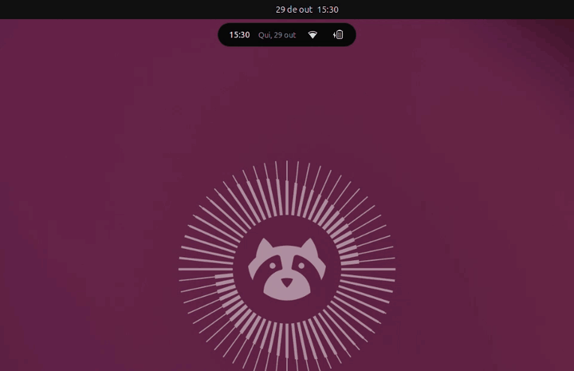</p>

- [Abas](#abas)
- [Estados da pílula](#estados-da-pílula)
- [Posição](#posição), [Fundo](#fundo) e [Animações](#animações)
- [Instalação](#instalação)
- [Sessões do Claude Code](#sessões-do-claude-code), [Codex e Gemini CLI](#codex-e-gemini-cli)
- [Scripts](#scripts), [Imagens](#imagens) e [Estrutura](#estrutura)

## Abas

| Aba               | O que mostra                                                                                                                                                                                                                                                                                               |
| ----------------- | ---------------------------------------------------------------------------------------------------------------------------------------------------------------------------------------------------------------------------------------------------------------------------------------------------------- |
| Geral             | Controles do Quick Settings nativo, inclusive o estilo escuro (emprestados enquanto a aba está aberta) ao lado de som, microfone e brilho com o dispositivo de cada um; embaixo, atalhos e programas abertos empilhados ao lado do player (capa grande, álbum, progresso), ou lado a lado quando nada toca |
| Calendário        | Grade do mês e lista de eventos do calendário nativo                                                                                                                                                                                                                                                       |
| Áreas de trabalho | Uma miniatura por área de trabalho, com as janelas abertas; clicar ativa a área, e há o card Nova área                                                                                                                                                                                                     |
| IA                | Claude Code, Codex e Gemini CLI. Em Todos, um card por assistente (plano, duas cotas e sessões ativas) e a lista única de sessões; em cada um, limites, consumo de tokens e as sessões dele. A cota do Gemini é estimada pelos pedidos do dia, porque o CLI não a informa                                  |
| Notificações      | Lista de notificações, não perturbe e limpar tudo                                                                                                                                                                                                                                                          |
| Desempenho        | CPU, memória, GPU e disco, com histórico de 60 s; os 5 processos que mais gastam, ordenáveis por CPU, RAM ou GPU, com botão para encerrar (pede confirmação; processos de outro usuário ou essenciais à sessão têm cadeado). Só lê `/proc` com a aba aberta                                                |

<table>
  <tr>
    <td width="50%">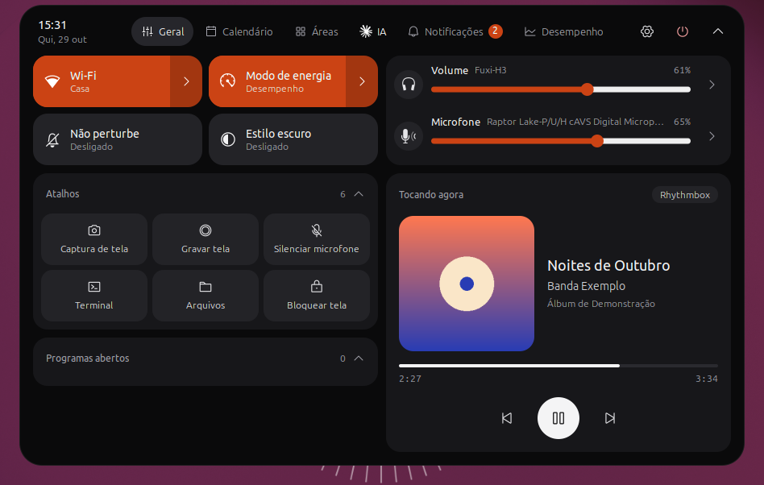<br><sub>Geral</sub></td>
    <td width="50%">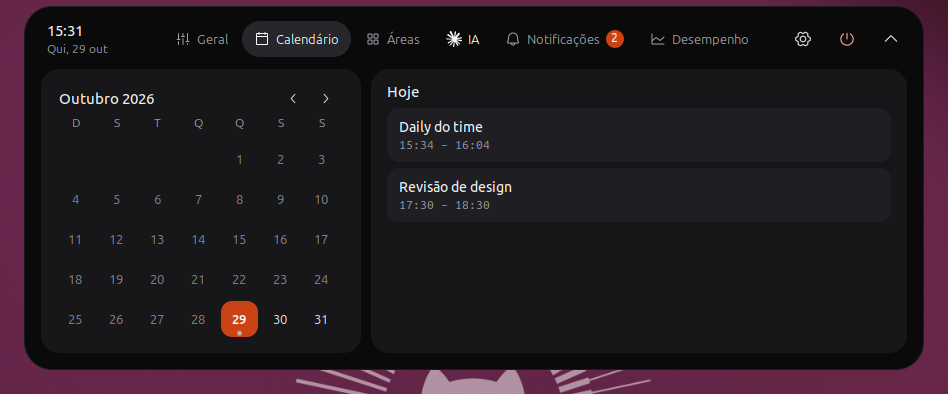<br><sub>Calendário</sub></td>
  </tr>
  <tr>
    <td>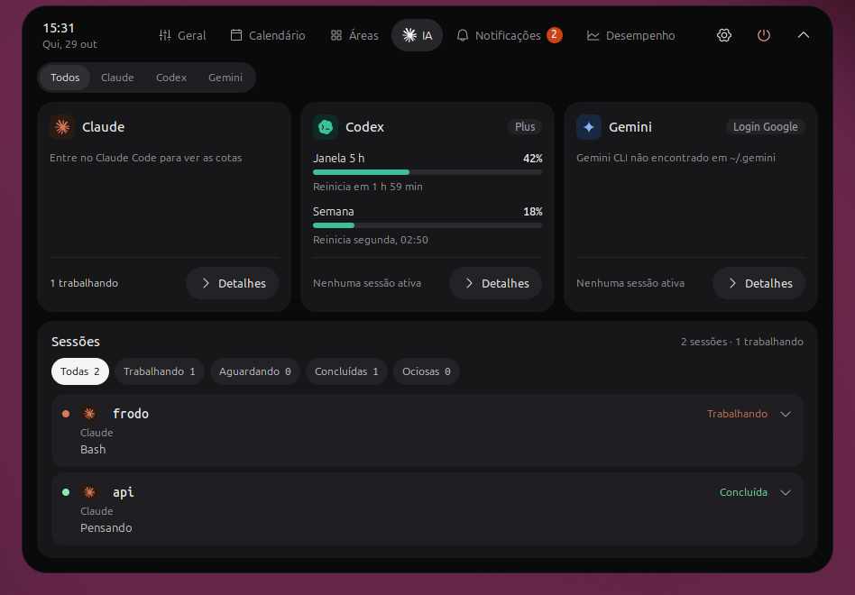<br><sub>IA</sub></td>
    <td>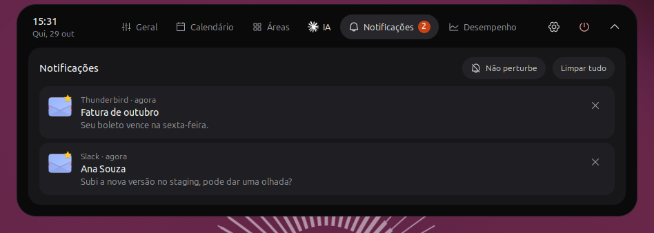<br><sub>Notificações</sub></td>
  </tr>
  <tr>
    <td>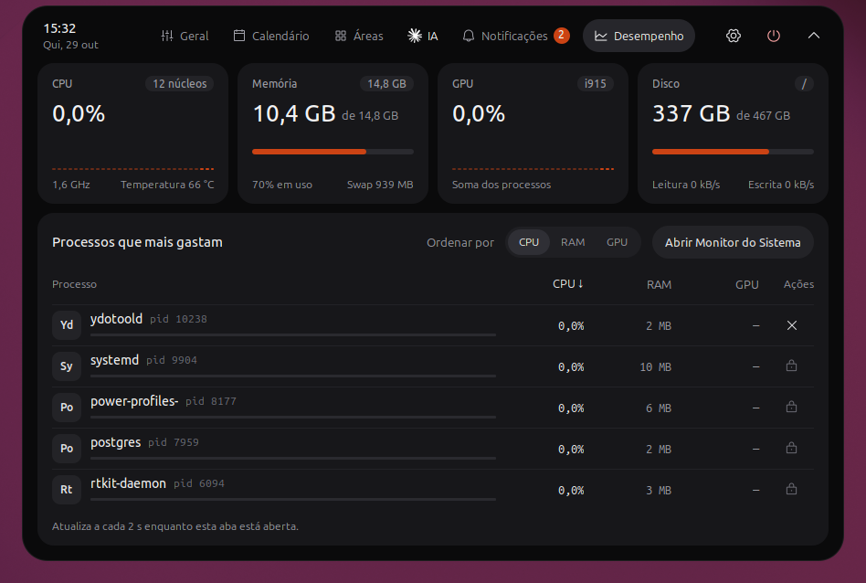<br><sub>Desempenho</sub></td>
    <td>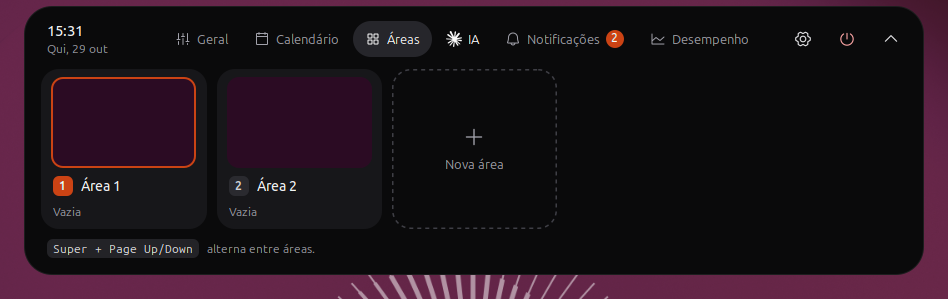<br><sub>Áreas de trabalho</sub></td>
  </tr>
</table>

A engrenagem do cabeçalho abre as configurações, todas dentro da ilha, numa barra lateral com seis seções: Geral (comportamento e atalhos), Tela e posição (grade 3×3, monitores, fundo e barra superior), Pílula, Abas, IA (intervalo de atualização, restante ou usado, e um grupo por assistente com o switch Acompanhar, perfis do Claude, hooks do Codex e do Gemini e limite diário do Gemini) e Agenda (Google Agenda e aviso antes da reunião); não há janela de preferências separada. O botão ao lado dela abre o menu de energia (suspender, encerrar sessão, reiniciar e desligar). Durante uma gravação de tela, o cabeçalho mostra Parar gravação. Em Configurações › Abas dá para ocultar cada aba e mudar a ordem delas arrastando pela alça (ou com ↑ ↓ na alça focada); a ilha abre na primeira aba visível. Se todas forem ocultadas, a primeira continua visível.

<p align="center">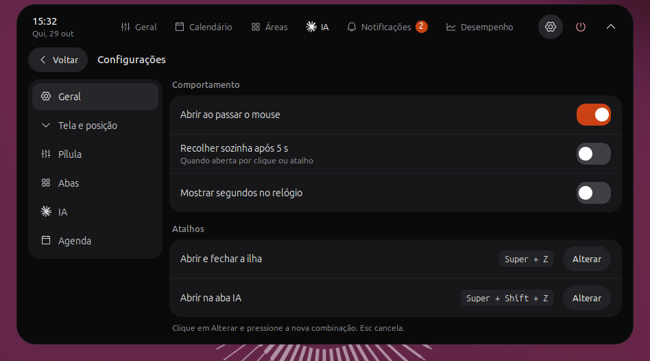</p>

## Estados da pílula

<p align="center">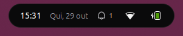</p>

Fechada, a pílula mostra hora, data, notificações, rede e bateria. Em Configurações › Pílula dá para escolher o modo (Mínimo, só o relógio; Compacto, tudo junto; Rotativo, com bateria, RAM e as cotas de IA revezando num espaço a cada poucos segundos), a ordem dos itens (arrastando o chip pela alça, ou com ← → na alça focada) e quais entram, com uma prévia da pílula de verdade no topo. Os ícones do sistema podem entrar separados (Bluetooth, Som, Microfone, Não perturbe e Bateria, os mesmos da barra superior, que só aparecem quando o GNOME os mostra; "Mostrar porcentagem da bateria" em Configurações › Pílula liga a porcentagem nativa do GNOME; "RAM em porcentagem" troca `RAM 9.8G` por `RAM 61%`) e o resto fica em "Outros ícones do sistema", sem repetir rede e bateria. Codex · 5 h, Codex · semana e Gemini · hoje entram com um anel na cor do assistente; itens de um assistente desligado em Configurações › IA somem. Há também "Ícones de extensões": os indicadores que outras extensões põem na barra superior (AppIndicator, monitores de recurso e afins) aparecem na pílula, só para ver; clicar continua abrindo a ilha. Quando algo acontece, ela troca para uma atividade por no máximo 5 segundos e volta ao repouso; a mesma atividade só reaparece quando muda (gravação nova, outra faixa, música retomada). A IA trabalhando (Claude Code, Codex e Gemini CLI, com o repo e o arquivo ou comando do passo) segue "Atividade da IA" em Configurações › Pílula: Ao mudar (padrão) mostra cada passo novo por 3 segundos e ignora as trocas da mesma sessão nos 10 segundos seguintes, para não piscar; Sempre deixa a sessão com o evento mais recente na pílula enquanto trabalha; Nunca não mostra. Pedido de permissão e sessão esperando aparecem em qualquer modo. Abrir a ilha dá como vistas as atividades em andamento. Com mais de uma ao mesmo tempo, vale esta ordem de prioridade, e a que foi interrompida volta depois com o tempo inteiro (5 segundos; 3 para a IA trabalhando):

1. Notificação recebida (qualquer uma que não seja crítica), por 5 segundos cada. Vira um card com o avatar arredondado, o app, o título e o corpo. Notificações que chegam com a tela bloqueada aparecem na pílula ao desbloquear. Quando a RAM passa de 90% em uso, o Frodo manda a notificação "Memória alta" (de novo só depois de cair abaixo de 80%). Quando uma sessão do Claude Code, Codex ou Gemini CLI termina a resposta, sai "Pronto" com o ícone e o nome do assistente e o repo (desliga em Configurações › IA › Uso, "Avisar quando terminar"). Quando uma cota (Claude 5 h e semana, Codex 5 h e semana, Gemini dia) cruza 80% ou 95%, sai "Cota em 80%" ou "Cota em 95%", uma vez por janela e com o ícone do assistente, e "Cota renovada" quando ela volta para baixo de 80% ("Avisar cota em 80% e 95%", no mesmo lugar).
2. Gravação de tela, com o tempo e o botão Parar (o cabeçalho da ilha também tem Parar gravação).
3. Pedido de permissão do Claude Code ou do Codex, com a ferramenta e os botões Negar e Aprovar (o mais antigo, se houver vários).
4. Sessão esperando permissão sem pedido aberto pela ilha (sempre o caso do Gemini CLI), com o botão Abrir.
5. Reunião em breve, com a contagem regressiva e o botão Entrar quando o evento tem link do Google Meet (lido do Evolution Data Server); sem link, o botão Abrir leva ao Calendário.
6. Volume alterado, por 1,5 segundo.
7. Sessão de IA trabalhando, com o repo, o passo (arquivo ou comando) e o tempo, conforme "Atividade da IA" (Ao mudar, Sempre ou Nunca).
8. Música tocando, com capa redonda, título e botão de pausa.

| Notificação                                                              | Pedido de permissão                                                    | Sessão trabalhando                                                          |
| ------------------------------------------------------------------------ | ---------------------------------------------------------------------- | --------------------------------------------------------------------------- |
|  | 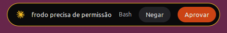 | 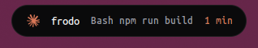 |

Clicar ou passar o mouse na pílula durante uma notificação abre a ilha na aba Notificações; durante uma sessão de IA trabalhando, na aba IA. Sem atividade, ela abre na Geral.

Em tela cheia (um vídeo, um jogo) a pílula e a lingueta somem; a pílula só volta para um pedido de permissão ou uma sessão de IA esperando aprovação (Claude Code, Codex e Gemini CLI). De tempos em tempos (padrão: a cada 10 min, no múltiplo do relógio) ela volta por alguns segundos (padrão: 10 s) só com a hora e uma barra que encolhe; intervalo, duração e o liga/desliga ficam em Configurações › Pílula › Tela cheia. Com a barra superior visível ou oculta, quando há uma janela maximizada ou encaixada na metade da tela visível no monitor, mesmo sem foco, a pílula vira a lingueta (passe o mouse ou clique nela para abrir a ilha) e volta por cima da janela enquanto mostra uma notificação ou um pedido de permissão; "Sempre à mostra", em Configurações › Pílula, mantém a pílula no lugar e dispensa a lingueta. A ilha desliga o scanout direto do compositor, como o GNOME faz com banners e OSD, para a pílula e a dock não piscarem sobre o app.

## Posição

Em Configurações › Tela e posição, a grade 3×3 põe a ilha no topo ou embaixo (à esquerda, ao centro ou à direita) ou no meio de uma das laterais; o centro da tela fica de fora. No meio da lateral, a pílula fica vertical, com os itens empilhados, e a ilha abre centrada nela. A lingueta (com janela maximizada ou em tela cheia) sai da mesma borda em que a pílula está: do topo, de baixo ou da lateral. A ilha sempre flutua dentro da área útil do monitor: no topo, logo abaixo da barra superior (ou colada no topo, com a barra oculta); embaixo, acima da dock, abrindo para cima. Nos cantos ela encosta na borda da tela; ao centro, fica a 6 px dela.

## Fundo

Em Configurações › Tela e posição, "Fundo" escolhe o estilo da pílula, da lingueta e da ilha: Sólido (preto, o padrão), Fosco ou Translúcido. Nos dois últimos o fundo fica translúcido e o que está atrás aparece desfocado: papel de parede e janelas, com os cantos arredondados da forma. No Translúcido, os blocos e controles de dentro da ilha também ficam translúcidos. O desfoque é do próprio Frodo e não depende do Blur my Shell.

## Animações

As trocas de estado seguem a Dynamic Island do iPhone. A pílula muda de tamanho com mola e troca o conteúdo com fade cruzado; volume, passo do Claude e timers mudam no lugar, sem piscar. Ao abrir, a forma cresce a partir da pílula e o conteúdo aparece dentro dela no mesmo frame, com fade curto e zoom leve; ao fechar, o conteúdo desfoca e a forma volta para a pílula. As abas, as configurações e os submenus de Wi-Fi, Bluetooth e áudio deslizam para o lado, assim como a troca de IA, de período e de filtro na aba IA; a seção das configurações entra de cima ou de baixo, o marcador da aba e dos seletores segmentados e a altura da ilha acompanham com mola, os acordeões e os detalhes de uma sessão abrem e fecham com mola e as notificações dispensadas saem deslizando. Hover e clique trocam de cor com transição curta. Com "Animações" desligada no GNOME, tudo troca na hora.

## Requisitos

- GNOME Shell 50 (Wayland)
- Node.js 20+ e npm (só para desenvolvimento)
- `gjs` e `glib-compile-schemas`

## Instalação

### Com um comando

```bash
curl -fsSL https://raw.githubusercontent.com/matheusjurkovich/frodo/master/linux/get.sh | sh
```

O `get.sh` baixa o zip da release `linux-v*` mais nova, instala com `gnome-extensions`, compila o schema e liga a extensão; não precisa clonar o repositório nem de Node. Rodar de novo atualiza. No Wayland, saia e entre na sessão para carregar. Se a extensão estiver instalada pelo `install.sh` (link para `dist/`), ele para sem mexer.

### Pela release

Baixe o `frodo-linux-<versão>.zip` da [página de releases](https://github.com/matheusjurkovich/frodo/releases) (tags `linux-v*`) e instale:

```bash
gnome-extensions install --force frodo-linux-<versão>.zip
```

O mesmo zip é o pacote para enviar ao [extensions.gnome.org](https://extensions.gnome.org/upload/): leva só o que roda, com o schema em XML e sem o compilado.

### Do código-fonte

```bash
cd linux
npm install
./install.sh
```

O `install.sh` compila para `dist/` e liga `dist/` em `~/.local/share/gnome-shell/extensions/frodo@matheusjurkovich.github.io`. No Wayland, saia e entre na sessão para o GNOME carregar o código novo, depois:

```bash
gnome-extensions enable frodo@matheusjurkovich.github.io
```

## Sessões do Claude Code

A aba IA mostra as sessões abertas do Claude Code a partir de um hook. A cada evento, `hooks/claude-session.sh` grava o último evento da sessão em `$XDG_RUNTIME_DIR/frodo/sessions/<session_id>.json`, junto com o pid do Claude (`$CLAUDE_PID`). A extensão acompanha essa pasta com `Gio.FileMonitor` e tira da lista a sessão que acabou (`SessionEnd`) ou cujo processo morreu.

Acrescente o bloco abaixo ao `~/.claude/settings.json`, junto com o que já houver em `hooks`. É o mesmo comando em todos os eventos.

<details>
<summary>Bloco <code>hooks</code> para o <code>settings.json</code></summary>

```json
{
  "hooks": {
    "SessionStart": [
      {
        "hooks": [
          {
            "type": "command",
            "command": "~/.local/share/gnome-shell/extensions/frodo@matheusjurkovich.github.io/hooks/claude-session.sh"
          }
        ]
      }
    ],
    "UserPromptSubmit": [
      {
        "hooks": [
          {
            "type": "command",
            "command": "~/.local/share/gnome-shell/extensions/frodo@matheusjurkovich.github.io/hooks/claude-session.sh"
          }
        ]
      }
    ],
    "PreToolUse": [
      {
        "hooks": [
          {
            "type": "command",
            "command": "~/.local/share/gnome-shell/extensions/frodo@matheusjurkovich.github.io/hooks/claude-session.sh"
          }
        ]
      }
    ],
    "PostToolUse": [
      {
        "hooks": [
          {
            "type": "command",
            "command": "~/.local/share/gnome-shell/extensions/frodo@matheusjurkovich.github.io/hooks/claude-session.sh"
          }
        ]
      }
    ],
    "PostToolUseFailure": [
      {
        "hooks": [
          {
            "type": "command",
            "command": "~/.local/share/gnome-shell/extensions/frodo@matheusjurkovich.github.io/hooks/claude-session.sh"
          }
        ]
      }
    ],
    "PermissionRequest": [
      {
        "hooks": [
          {
            "type": "command",
            "command": "~/.local/share/gnome-shell/extensions/frodo@matheusjurkovich.github.io/hooks/claude-session.sh"
          }
        ]
      }
    ],
    "Notification": [
      {
        "hooks": [
          {
            "type": "command",
            "command": "~/.local/share/gnome-shell/extensions/frodo@matheusjurkovich.github.io/hooks/claude-session.sh"
          }
        ]
      }
    ],
    "PreCompact": [
      {
        "hooks": [
          {
            "type": "command",
            "command": "~/.local/share/gnome-shell/extensions/frodo@matheusjurkovich.github.io/hooks/claude-session.sh"
          }
        ]
      }
    ],
    "Stop": [
      {
        "hooks": [
          {
            "type": "command",
            "command": "~/.local/share/gnome-shell/extensions/frodo@matheusjurkovich.github.io/hooks/claude-session.sh"
          }
        ]
      }
    ],
    "SessionEnd": [
      {
        "hooks": [
          {
            "type": "command",
            "command": "~/.local/share/gnome-shell/extensions/frodo@matheusjurkovich.github.io/hooks/claude-session.sh"
          }
        ]
      }
    ]
  }
}
```

</details>

Cada perfil do Claude Code (`CLAUDE_CONFIG_DIR`, como `~/.claude-trabalho`) tem o próprio `settings.json` e precisa do mesmo bloco. Sem ele, as sessões daquele perfil não aparecem.

### Aprovar pela ilha

No `PermissionRequest`, o hook cria `$XDG_RUNTIME_DIR/frodo/pending/<session_id>.<pedido>.json` e espera a resposta em `decisions/` com o mesmo nome. A pílula e a linha expandida da sessão na aba IA mostram Negar e Aprovar enquanto o processo do hook estiver vivo; o clique grava a decisão e o hook a devolve ao Claude Code (negar manda "Negado pela ilha do Frodo." e o Claude segue trabalhando). O Codex usa o mesmo protocolo (o hook recebe `codex` como argumento). O diálogo do próprio Claude Code continua valendo: respondido lá, o hook percebe pelo próximo evento da sessão e sai.

O hook só espera se a extensão estiver ligada (ela grava o pid do shell em `$XDG_RUNTIME_DIR/frodo/alive`); desligada, o pedido segue só no diálogo, sem atraso. Ele espera até 590 s em sessões do Claude desktop (`CLAUDE_CODE_ENTRYPOINT=claude-desktop`) e 15 s nas demais. O `timeout` do `PermissionRequest` no `settings.json` precisa ficar ausente (padrão de 600 s) ou ser 600; com um valor menor, o Claude Code mata a espera antes do clique.

### Codex e Gemini CLI

Em Configurações › IA, "Instalar hook" acrescenta o mesmo `hooks/claude-session.sh` com o argumento `codex` em `~/.codex/hooks.json` (ou `$CODEX_HOME`) e com `gemini` em `~/.gemini/settings.json`, sem mexer nos hooks que já existem (o arquivo anterior fica em `<arquivo>.frodo.bak`). Reinicie o CLI depois; o Codex pede para confiar no hook novo.

- **Codex:** sessões com status e pedidos de permissão aprovados ou negados pela ilha, como no Claude Code. Cotas (janela de 5 h e semana) e consumo vêm de `~/.codex/sessions/**/rollout-*.jsonl`.
- **Gemini CLI:** só status. O Gemini não deixa responder pedidos por hook (`BeforeTool` com `allow` não pula a confirmação e `Notification` é só aviso), então a pílula avisa e oferece Abrir. Consumo vem de `~/.gemini/tmp/*/chats/`; a cota é estimada contando os pedidos desde a meia-noite do Pacífico contra o limite escolhido (1.000, 1.500 ou 2.000).

## Scripts

| Comando                 | O que faz                                                                               |
| ----------------------- | --------------------------------------------------------------------------------------- |
| `npm run build`         | Compila `src/` para `dist/` e copia metadata, CSS, ícones, schemas e hooks              |
| `npm run typecheck`     | `tsc` em modo strict no código e nos testes                                             |
| `npm run lint`          | ESLint (typescript-eslint strict + stylistic e fronteiras das camadas)                  |
| `npm run format`        | Prettier                                                                                |
| `npm test`              | Jasmine rodando no `gjs`, com todo `*.spec.ts` de `src/` e `tests/`                     |
| `npm run check`         | Tudo acima, menos o build                                                               |
| `npm run smoke`         | Build e gnome-shell headless isolado: liga, desliga e religa a extensão                 |
| `npm run devkit`        | Build e gnome-shell aninhado numa janela para conferir ao vivo                          |
| `npm run screenshots`   | Build e gnome-shell headless com dados de exemplo; grava `docs/*.png` e `docs/demo.gif` |
| `npm run pack -- X.Y.Z` | Build e `frodo-linux-X.Y.Z.zip` para a release e o extensions.gnome.org                 |

## Imagens

As imagens deste README e do da raiz saem de `npm run screenshots` (`tools/screenshots/run.sh`). Ele sobe um gnome-shell headless isolado, como o smoke, com dados de exemplo: sessões do Claude Code pelo hook de verdade, cotas do Codex num rollout falso, eventos num calendário local, notificações por `notify-send` e um player MPRIS (`tools/screenshots/mpris.js`). Uma extensão auxiliar (`tools/screenshots/probe/`) libera o `Eval` do shell e move um ponteiro virtual só para passar o mouse na pílula; abas e botões são acionados com `emit('clicked')`, sem clique de verdade, para não mexer no Wi-Fi ou Bluetooth reais. O nome da rede no tile de Wi-Fi vira "Casa".

O GIF é gravado pelo `org.gnome.Shell.Screencast`, convertido em quadros pelo GStreamer e montado pelo `tools/screenshots/gif.py` (Pillow). Precisa de `gst-launch-1.0` com o decodificador do MP4 e de `python3-pil`. Rode de novo quando a UI mudar e confira as imagens antes do commit.

## Estrutura

Código agrupado por camada e domínio. Import só desce: `app → pill, tabs → features → settings → shared`.

```
src/
  extension.ts            enable/disable: ícones, createServices, barra do topo, ilhas e atalhos
  app/                    a ilha: services.ts (cria os serviços), island.ts (um monitor), island-manager.ts
                          (um por monitor), panel-content.ts, header.ts, tab-bar.ts, power-menu.ts,
                          top-bar-visibility.ts e monitors.ts
  pill/                   pílula: visão ociosa, visão de atividade, feed e prioridade das atividades
  tabs/<aba>/             uma pasta por aba: general, calendar, workspaces, claude (aba IA), notifications, performance, settings
  features/<domínio>/     regra pura e serviço de cada fonte de dados: claude, codex, gemini, media, meetings,
                          notifications, system, workspaces
  settings/               GSettings tipado, valores do schema, perfis do Claude, atalho e abas
  shared/                 Emitter, Disposables, Timer, formatação, geometria, curva de mola, leitura de arquivo, nível,
                          contrato da ilha para as abas (island-handle.ts) e shell-internals.ts
    ui/                   componentes St: botões, cards, layout, anel, barra de segmentos, ícones, empréstimo de ator,
                          movimento (motion.ts)
  types/                  declarações que faltam nos tipos @girs
tests/                    runner Jasmine (entry.js acha todo *.spec.ts), polyfills e fixtures
tools/smoke.sh            gnome-shell headless isolado: liga, desliga e religa a extensão
tools/devkit.sh           gnome-shell aninhado numa janela, isolado, para conferir ao vivo
tools/screenshots/        imagens da doc: run.sh (headless com dados de exemplo), probe, player MPRIS e GIF
docs/                     imagens geradas por npm run screenshots
../shared/hooks/          hook do Claude Code que grava o estado de cada sessão (o build copia para dist/hooks/)
../shared/icons/          ícones SVG simbólicos (créditos em ../shared/icons/README.md)
```

Fontes de dados em `src/features/`:

- Configurações (`src/settings/frodo-settings.ts`): GSettings tipado.
- RAM e bateria (`system/system-state-service.ts`, `system/memory-service.ts`, `system/battery-service.ts`): leitura de `/proc/meminfo` e UPower.
- Notificações (`notifications/notification-bridge-service.ts`): fila do shell, contagem e avisos para a pílula.
- Claude (`claude/claude-service.ts`, `claude/claude-client.ts`, `claude/claude-profiles-service.ts`): uso e limites por perfil. Só lê o token de `.credentials.json`; quem renova é o próprio Claude Code. Com o token vencido, os últimos números ficam na tela com "Uso desatualizado. Abra o Claude Code para atualizar." até o Claude Code ser usado de novo.
- Transcrições do Claude (`claude/claude-transcripts-service.ts`): índice persistente em `$XDG_CACHE_HOME/frodo/claude-index.json`, lido em pedaços e só nos bytes novos.
- Sessões de IA (`claude/claude-sessions-service.ts`): estado vindo do hook (Claude Code, Codex e Gemini CLI, cada uma com o seu `provider`), acompanhado com `Gio.FileMonitor`; também instala os hooks do Codex e do Gemini.
- Codex (`codex/codex-service.ts`): cotas pela cauda do rollout mais novo e consumo dos últimos 30 dias.
- Gemini CLI (`gemini/gemini-service.ts`): pedidos do dia (cota estimada) e consumo dos últimos 30 dias.
- Mídia (`media/media-service.ts`): MPRIS com proxies próprios.
- Áreas de trabalho (`workspaces/workspaces-service.ts`), gravação de tela (`system/recording-service.ts`), volume (`system/volume-service.ts`) e reuniões (`meetings/meetings-service.ts`, com o link do Meet por `meetings/meet-link-client.ts`).
- Desempenho (`system/performance-service.ts`): CPU, memória, disco e processos por `/proc`, GPU pelo `fdinfo` do DRM (Intel e AMD; NVIDIA proprietária não expõe), a cada 2 s só com a aba aberta.

Regras da arquitetura:

- Import só desce: `app → pill, tabs → features → settings → shared` (ESLint).
- Em `features/`, só `*-service.ts` e `*-client.ts` falam com o GNOME; o resto é regra pura, coberta por testes (ESLint).
- Feature não importa feature; aba não importa aba (ESLint). As abas falam com a ilha pelo `IslandHandle`.
- Spec ao lado do arquivo que testa (`<nome>.spec.ts`), descoberto sozinho pelo `npm test`.
- Serviço não conhece a UI; a UI assina eventos tipados (`Emitter`).
- Todo `connect`, timer e patch feito no `enable()` é desfeito no `disable()` através de `Disposables` (`npm run smoke` religa a extensão).
- Acesso a internals privados do shell fica isolado em `src/shared/shell-internals.ts`.
- Controles do sistema reaproveitam o Quick Settings nativo do GNOME (emprestado enquanto a ilha está aberta), em vez de reimplementá-los.
- Cor só existe no `stylesheet.css`. O código TypeScript não guarda cor; o desenho em Cairo lê a cor do tema (`get_theme_node()`).
- O destaque (tile ligado, dia selecionado, botão primário, contador, anel da área ativa) vem do accent do sistema (`-st-accent-color`), então trocar o accent do GNOME muda a ilha na hora. Só as cores de marca e de estado (Claude, modelos, ok, aviso e perigo) são fixas.
- Card ou página que lê disco ou D-Bus periodicamente só roda enquanto está visível (`whileMapped`).

## Licença e créditos

Frodo é distribuído sob a **GPL-2.0** (`LICENSE`).

A lógica da aba do Claude (leitura das credenciais do Claude Code, renovação do token, janelas de uso, uso extra, ritmo e projeção, plano da assinatura e perfis) foi portada para TypeScript a partir do [Claude Code Usage Monitor](https://github.com/dvdstelt/ClaudeCodeUsage), de Dennis van der Stelt, também GPL-2.0.

Ícones: [Phosphor Icons](https://phosphoricons.com) (MIT) e logo do Claude do [Simple Icons](https://simpleicons.org) (CC0). Detalhes em `../shared/icons/README.md`.
